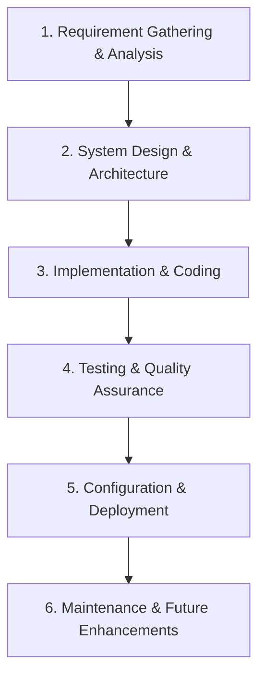

# Software Development Life Cycle (SDLC) 🔄

This document outlines the structured Software Development Life Cycle (SDLC) followed in designing, implementing, testing, and preparing the **Mini Banking Backend System** for deployment.



---

## Phase 1: Requirement Gathering & Analysis 📋

During this initial phase, the business goals of a mini bank transaction ledger were translated into specific functional and non-functional requirements.

### 1. Functional Requirements
- **User Registrations**: Secure addition of customer details. Email and Username must be unique system-wide.
- **Account Generation**: Users should be able to open bank accounts. The system must automatically generate a unique, non-guessable 10-digit account number.
- **Deposit & Withdrawal**: Support cash credits and debits on a specific account, validating that the transaction amount is positive and that withdrawals do not exceed the balance.
- **Fund Transfers**: Transfer funds between two user accounts in an atomic transaction (all-or-nothing).
- **Audit Trails**: Maintain a transaction ledger for every single deposit, withdrawal, and transfer, supporting paginated lookup.

### 2. Non-Functional Requirements
- **Consistency (ACID)**: Transactions must adhere to ACID principles. Under no circumstances should money be lost or duplicated.
- **Concurrency Safety**: The system must support high concurrent requests on the same account (e.g. concurrent transfers) without leading to race conditions or lost updates.
- **Deadlock Immunity**: Concurrency mechanisms must not cause database deadlocks.
- **High-Precision Arithmetic**: Calculations must avoid floating-point representation limits.

---

## Phase 2: System Design & Architecture 🏗️

The project utilizes a layered, clean architecture to separate concerns, improve maintainability, and allow modular swapping of databases.

```
+-------------------------------------------------+
|               Client (REST API)                 |
+-------------------------------------------------+
                        |
                        v
+-------------------------------------------------+
|         Controller Layer (Validation)           |
+-------------------------------------------------+
                        |
                        v
+-------------------------------------------------+
|          Service Layer (Business Logic)         |
+-------------------------------------------------+
                        |
                        v
+-------------------------------------------------+
|     Repository Layer (Spring Data JPA / SQL)    |
+-------------------------------------------------+
                        |
                        v
+-------------------------------------------------+
|     Database Layer (H2 / MySQL / PostgreSQL)    |
+-------------------------------------------------+
```

### 1. Data Models (Database Schema)
- **`User` (Entity)**: `id` (PK), `username` (Unique), `email` (Unique), `fullName`, `createdAt`.
- **`Account` (Entity)**: `id` (PK), `accountNumber` (Unique, Indexed), `balance` (BigDecimal), `userId` (FK), `createdAt`.
- **`Transaction` (Entity)**: `id` (PK), `type` (DEPOSIT, WITHDRAWAL, TRANSFER), `amount`, `sourceAccountId` (FK, Nullable), `destinationAccountId` (FK, Nullable), `description`, `timestamp`.

### 2. Transaction Concurrency Design
- **Pessimistic Write Locks**: To lock balance records during write operations, we implement a database-level `SELECT ... FOR UPDATE` query in JPA:
  ```java
  @Lock(LockModeType.PESSIMISTIC_WRITE)
  @Query("SELECT a FROM Account a WHERE a.accountNumber = :accountNumber")
  Optional<Account> findByAccountNumberForUpdate(String accountNumber);
  ```
- **Deadlock Prevention Policy**: circular locking is prevented by sorting the account locking sequence. For any transfer between Account X and Account Y, the application lexicographically compares the account numbers and locks the alphabetically lower account number first.

---

## Phase 3: Implementation & Coding 💻

During implementation, the design was coded into production-ready Spring Boot files.

### Key Development Standards:
- **Java Records & DTOs**: Input request parameters and output response records are mapped through DTOs, isolating database entities from the network layer.
- **Input Validation**: Jakarta Bean Validation annotations (`@NotBlank`, `@Email`, `@DecimalMin`, etc.) validate incoming client payloads at the Controller boundary.
- **Custom Exceptions**: Handled business logic exceptions (e.g. `InsufficientBalanceException`, `DuplicateResourceException`) mapped using a `@RestControllerAdvice` global exception handler returning formatted HTTP responses.
- **Pre-Persist Lifecycle Hooks**: Models leverage `@PrePersist` to automatically write audit timestamps and generate default values.

---

## Phase 4: Testing & Quality Assurance 🧪

Quality assurance was integrated into the development process to verify both correctness of single-threaded code and resilience under heavy concurrent stress.

### 1. Automated Unit and Integration Tests
- **Context Loading Tests**: Confirms Spring Boot dependency injection starts correctly.
- **Integration Tests**: Tests user registration, account opening, invalid deposit validation, and balance checks.
- **Exception Verification**: Ensures insufficient funds during withdrawals and transfers trigger the proper HTTP 400 Bad Request error codes and roll back database changes.

### 2. Concurrency Stress Tests
- **Multi-Threaded Concurrent Deposits**: Evaluates 10 threads doing 10 deposits each concurrently. Confirms the final balance matches the exact summation, proving that pessimistic write locks prevent lost updates.
- **Concurrent Back-and-Forth Transfers (Deadlock Stress Test)**: Spawns 8 concurrent threads executing 80 total transfers between Account A and Account B in opposite directions. Verifies that the lexicographical locking order completely eliminates database deadlock conditions under heavy contention.

---

## Phase 5: Configuration & Deployment 🚀

The project is structured to make configuration management easy and portable:

1. **Environment Profiles**:
   - `dev` (H2 Database): Perfect for local sandbox running. Auto-initializes schema on boot.
   - `mysql` (MySQL Database): Configured for production persistent storage.
   - `postgres` (PostgreSQL Database): Configured for cloud deployments.
2. **Build Tooling**: Uses Maven wrapper (`mvnw`) to eliminate local Maven installation requirements, making the project instantly buildable across CI/CD platforms.
3. **Execution**: Package can be compiled into a standalone, runnable JAR containing embedded Apache Tomcat:
   ```bash
   ./mvnw clean package
   java -jar target/system-0.0.1-SNAPSHOT.jar
   ```

---

## Phase 6: Maintenance & Future Enhancements 🛠️

As the application moves past the initial release, the maintenance roadmap includes:

1. **Security Layer**: Integrating Spring Security with JWT (JSON Web Tokens) or OAuth2 to authenticate REST requests and authorize access based on account ownership.
2. **Rate Limiting**: Implementing API rate limiting (e.g., using Bucket4j) to protect deposit/withdraw endpoints from DDoS attacks or script abuse.
3. **Caching**: Adding Redis caching on user profiles and transaction history queries to reduce database read loads.
4. **Event-Driven Messaging**: Publishing transaction events to Kafka or RabbitMQ to support downstream microservices (such as sending notification emails or calculating ledger analytics).
